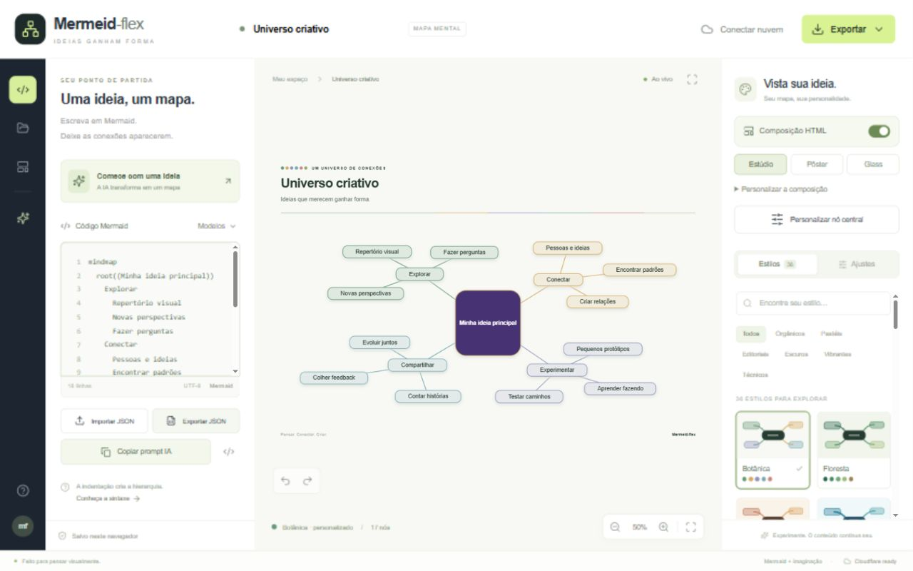

# Mermeid-flex

**Um estúdio de mapas mentais a partir de Mermaid, com 36 estilos, composição HTML/CSS e integração nativa com Cloudflare.** Interface em português, frontend estático e API em Workers. O nome do projeto é **Mermeid-flex**; a biblioteca de diagramas se chama **Mermaid**.



Exemplos exportados: [composição HTML independente](examples/universo-criativo.html) e [PNG completo](docs/images/composition-studio.png).

## O que está incluído

- Editor Mermaid com prévia, mensagens de erro, zoom, movimentação e tela cheia.
- Diagramas `mindmap` e `flowchart`/`graph`, com quatro modelos iniciais.
- **36 presets**, em seis famílias, 12 parâmetros visuais gerais e quatro ajustes exclusivos do nó central.
- Edição do texto central de mindmaps, com controle próprio de fundo, texto, borda e arredondamento.
- Composição HTML com cartões, título, subtítulo, fundos e rodapé nos layouts Estúdio, Pôster e Glass.
- Biblioteca local com salvamento automático de rascunhos, duplicação e exclusão.
- Importação/exportação **JSON v1**, PNG da composição inteira, HTML independente, SVG do diagrama e `.mmd`.
- Botões diretos Importar JSON, Exportar JSON e Copiar prompt IA para pedir um mapa em outra ferramenta de IA.
- API autenticada, biblioteca D1, controle de revisão e snapshots JSON privados em R2.
- Geração por **Workers AI** com modelo Cloudflare, limites de tamanho e cotas diárias atômicas.
- JSON Schema, migração SQL, exemplos, testes e documentação operacional.

## Arquitetura e plano gratuito

Em produção, toda a hospedagem e os serviços ficam na Cloudflare: **Workers Static Assets + Worker + D1 + R2 + Workers AI**. Não exige Vercel, Supabase, OpenAI, servidor Node persistente, CDN externa, Google Fonts, domínio pago, KV, Durable Objects ou serviço de autenticação externo. O navegador faz a renderização; Node é apenas ferramenta de desenvolvimento/build.

**Projetado para as franquias gratuitas, não para uso ilimitado sem cobrança.** Mantenha o plano Workers Free. Workers AI tem franquia diária e o R2 exige uma assinatura própria com cobrança de excedentes. Os limites internos reduzem o consumo deste aplicativo, mas não limitam o restante da conta. Leia [COTAS.md](docs/COTAS.md) antes de ativar recursos remotos.

O frontend funciona sem configurar a nuvem. O salvamento local depende do armazenamento do navegador; não substitui uma cópia JSON. Não há service worker: abrir/recarregar o site exige acesso aos arquivos da aplicação.

A composição e suas exportações são processadas no navegador. Não adicionam serviço de captura, processamento de imagens no Worker ou custo de API. O HTML exportado inclui a composição pronta, sem scripts ou chamadas de rede; JSON continua sendo o formato para reabrir e editar o mapa.

Copiar prompt IA também funciona localmente: prepara um pedido com o tema escolhido, os ajustes visuais e o contrato JSON. Você cola o texto no serviço que escolher e importa a resposta como arquivo `.json`. O aplicativo não chama esse serviço nem inclui sua chave; a importação valida formato e Mermaid. A resposta de uma IA externa ainda pode conter erros. Veja [o fluxo de uso](docs/USO.md#usar-uma-ia-externa).

## Executar localmente

Requisitos: **Node.js 22.12+**, npm e um navegador moderno. Use `npm ci` para as versões exatas do lockfile.

```bash
npm ci
npm run setup:local
npm run dev:api
```

O último comando mantém um Worker local em **http://127.0.0.1:8787**, com o frontend compilado, D1 e R2 simulados. Não requer conta Cloudflare e **não simula respostas de IA**.

Para editar com atualização automática, em outro terminal:

```bash
npm run dev
```

Abra **http://127.0.0.1:5173**. A API é encaminhada ao Worker em 8787. No botão **Conectar nuvem**, use o `APP_ACCESS_TOKEN` de `.dev.vars`. O script de preparação copia uma chave pública de exemplo, **exclusiva para localhost**. Produção exige uma chave aleatória própria.

## Publicar na sua conta Cloudflare

Siga [o roteiro completo de implantação](docs/DEPLOY.md): criar D1 e R2, inserir o ID do banco, aplicar a migração, configurar o segredo e publicar. `npm run deploy` bloqueia a implantação quando o ID do D1 ainda é o placeholder.

Nenhuma credencial Cloudflare é colocada no frontend. A IA vem desligada por padrão para evitar consumo durante a configuração. O R2 é privado; o aplicativo o acessa por binding, sem URLs públicas.

## Documentação

| Documento                                          | Conteúdo                                                               |
| -------------------------------------------------- | ---------------------------------------------------------------------- |
| [DEPLOY](docs/DEPLOY.md)                           | Instalação, recursos, segredos, atualização, recuperação e diagnóstico |
| [ARQUITETURA](docs/ARQUITETURA.md)                 | Componentes, fluxos, decisões e consistência entre D1/R2               |
| [USO](docs/USO.md)                                 | Editor, estilos, biblioteca, IA, importações e exportações             |
| [API](docs/API.md)                                 | Rotas, autenticação, corpos, respostas, cotas e erros                  |
| [FORMATO-JSON](docs/FORMATO-JSON.md)               | Contrato v1, validação, portabilidade e exemplo                        |
| [ESTILOS](docs/ESTILOS.md)                         | Catálogo dos 36 presets, tokens e como estender                        |
| [COTAS](docs/COTAS.md)                             | Franquias verificadas, limites internos e condição de custo zero       |
| [SEGURANCA](docs/SEGURANCA.md)                     | Modelo de acesso, ameaças, privacidade e limitações                    |
| [TESTES](docs/TESTES.md)                           | Testes reproduzíveis e escopo de verificação                           |
| [JSON Schema](schemas/mermeid-flex.v1.schema.json) | Validação estrutural por ferramentas externas                          |

## Comandos

| Comando                | Efeito                                                 |
| ---------------------- | ------------------------------------------------------ |
| `npm run dev`          | Vite com HMR; não inicia a API                         |
| `npm run setup:local`  | Cria `.dev.vars` se ausente, compila e migra D1 local  |
| `npm run dev:api`      | Worker + assets compilados + D1/R2 locais              |
| `npm run build`        | Verifica TypeScript de frontend/backend e gera `dist/` |
| `npm test`             | Testes de contrato, entrada não confiável e estilos    |
| `npm run test:api`     | Integração em um Worker/D1/R2 temporários isolados     |
| `npm run schema`       | Regenera o JSON Schema e o exemplo versionado          |
| `npm run deploy:check` | Bundle do Worker em dry run; não publica               |
| `npm run db:remote`    | Aplica migrações no D1 remoto — altera sua conta       |
| `npm run deploy`       | Build e publicação em Cloudflare — altera sua conta    |

## Estrutura

```text
src/                Interface, composição HTML, exportação SVG/PNG/HTML e armazenamento local
shared/             Presets, validação e formato compartilhado
worker/             API e bindings Cloudflare
migrations/         Esquema D1 versionado
public/             Ícone e cabeçalhos HTTP dos assets
schemas/            JSON Schema gerado
examples/           Projeto portátil para importação
tests/              Testes unitários
scripts/            Preparação, geração de schema e teste da API
docs/               Guias de usuário, implementação e operação
wrangler.jsonc      Configuração de produção
wrangler.local.jsonc Configuração local sem binding remoto de IA
```

## Escopo e limites conhecidos

Um deployment representa **um espaço privado**, acessível a todos que possuem sua chave. Não há contas individuais, papéis, cobrança por usuário ou colaboração em tempo real. Use uma aba de edição por biblioteca local. A API impede sobrescritas concorrentes no D1 por revisão, mas a biblioteca `localStorage` não é um banco colaborativo.

A aplicação aceita um subconjunto explícito de Mermaid; não promete todos os tipos de diagrama ou diretivas da biblioteca. O layout radial é calculado pelo Mermaid. A IA pode errar o conteúdo ou a sintaxe: suas respostas passam pelas validações, e respostas recusadas não substituem o mapa atual. Testes locais não comprovam disponibilidade, faturamento ou limites de CPU em produção.

Mapas novos começam com Composição HTML ligada. Arquivos e rascunhos antigos sem esse campo continuam no modo SVG. A versão 1.2.0 lê os arquivos anteriores, mas leitores antigos recusam campos que ainda não conhecem: `composition` foi adicionado em 1.1.0 e os quatro ajustes centrais em 1.2.0. Consulte [a compatibilidade do formato](docs/FORMATO-JSON.md#compatibilidade-da-composição) antes de trocar arquivos com instalações antigas. Exportar JSON exige que a prévia do código atual esteja válida; use `.mmd` para texto ainda incompleto.
