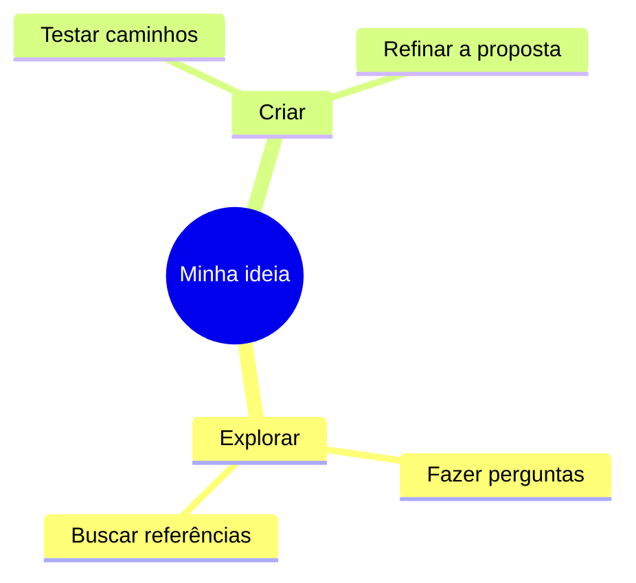

# Guia de uso

## Criar e editar

Ao abrir, o editor mostra Universo criativo ou um mapa da biblioteca local. Edite o título na barra superior e o código no painel esquerdo. O mapa se atualiza após uma curta pausa. Use Modelos para abrir um novo documento sem apagar o atual.

Dois espaços por nível ajudam a manter a hierarquia. Tab insere dois espaços no editor. `mindmap` é radial; para um fluxo, comece com `flowchart LR` e use `A[Ideia] --> B[Resultado]`. As direções disponíveis são LR, RL, TB, TD e BT. O [manual oficial Mermaid](https://mermaid.js.org/syntax/mindmap.html) explica a sintaxe completa, mas esta aplicação limita tipos e recursos conforme seu guia de segurança.

Uma sintaxe inválida mantém a última prévia válida com um aviso. A alteração continua no rascunho; imagens e exportação JSON ficam indisponíveis até o código atual renderizar corretamente. Aguarde a atualização da prévia antes de exportar. Use `.mmd` para salvar texto ainda incompleto.

## Personalizar

Na galeria, procure pelo nome ou filtre uma das seis famílias. Selecione um preset e abra Ajustes para alterar cores, tipografia, conexões, textura, sombras e cantos. Mudar de preset restaura todos os tokens daquele preset. Restaurar estilo remove apenas os ajustes.

Use +/− e Ajustar à tela, ou Ctrl/⌘ + roda do mouse. Arraste o mapa para mover. O botão Tela cheia amplia a área de trabalho. Em telas pequenas, o mapa vem primeiro e editor/estilos ficam abaixo; a navegação lateral continua acessível.

## Personalizar o nó central

Clique **Personalizar nó central** no painel de estilos. Em mindmaps com uma raiz simples reconhecida, o formulário permite alterar seu texto mantendo os ramos, a indentação e a forma Mermaid existente. Use de 1 a 100 caracteres em uma linha, sem HTML, URLs, aspas ou delimitadores Mermaid. O título do projeto continua independente. Formatos de raiz que não podem ser editados com segurança exibem orientação para usar o código.

Escolha fundo, cor do texto, borda e arredondamento de 0 a 80. Com **Contraste automático do texto** marcado, a cor do texto acompanha a luminância do fundo. O arredondamento afeta cartões HTML e retângulos SVG; não transforma um círculo ou losango em retângulo. Clique **Aplicar ao mapa** para validar e salvar as alterações.

**Usar cores e cantos do estilo** remove apenas esses quatro ajustes e devolve o centro aos valores herdados do preset/ajustes gerais, sem alterar seu rótulo ou os ramos. Trocar preset ou restaurar todos os ajustes também limpa as personalizações centrais. Em fluxogramas, os ajustes visuais afetam o primeiro nó; edite seu rótulo diretamente no código.

## Compor com HTML e CSS

No painel de estilos, ative **Composição HTML**. O Mermaid continua calculando a posição dos nós e das conexões; o aplicativo cria cartões HTML sobre essas posições e acrescenta título, subtítulo e acabamento. Não é necessário escrever HTML dentro do código Mermaid.

Escolha Estúdio, Pôster ou Glass nos controles da composição, escreva um subtítulo de até 180 caracteres e escolha se deseja mostrar o rodapé. O título vem do campo na barra superior. Os 36 presets e seus ajustes também definem as cores, fontes e o tratamento visual da composição. O modo SVG continua disponível ao desligar a opção.

Mapas novos começam com a composição ligada. Mapas antigos, inclusive JSON e rascunhos locais sem `composition`, mantêm a apresentação SVG até a opção ser ativada. As escolhas de composição ficam no documento e acompanham JSON, salvamento D1 e snapshot R2.

Os cartões usam o texto dos nós, não interpretam HTML arbitrário. Nos fluxogramas, somente nós retangulares recebem cartões HTML; losangos, círculos e outras formas especiais permanecem em SVG para preservar seu significado. Nos dois tipos de diagrama, geometria ou rótulos sem conversão segura também mantêm o nó SVG. Confira a legibilidade de rótulos extensos antes de exportar.

## Biblioteca e salvamento

O rascunho é salvo automaticamente no navegador. Na biblioteca, abra, duplique ou exclua mapas locais. Abrir outra origem/porta, navegar anonimamente, limpar dados do site ou usar outro dispositivo não dá acesso à mesma biblioteca. Uma aba por vez evita que bibliotecas locais concorrentes sobrescrevam o `localStorage`.

Conectar nuvem usa a chave do **espaço Mermeid-flex**, definida pelo administrador como `APP_ACCESS_TOKEN`; não use credenciais ou API Token de conta Cloudflare. A chave permanece somente na memória da aba. Após conectar, abra o mesmo botão e clique Salvar mapa no D1, ou use Ctrl/⌘+S. A nuvem recebe a versão atual manualmente. Uma indicação de rascunho local pendente significa que ainda há alterações não enviadas.

Em Meus mapas → Atualizar, consulte a biblioteca D1. Abrir uma versão da nuvem sobre alterações locais exige confirmação; duplique ou exporte antes de substituí-las. Conflito de revisão preserva o rascunho: reabra a versão remota ou duplique para criar outro documento.

## Snapshots

Na lista de mapas da nuvem, Criar snapshot R2 copia a versão **já salva no D1**. O snapshot anterior daquele mapa é substituído. Recuperar snapshot traz uma nova cópia local, com novo ID e sufixo “recuperado”. Para mantê-la também no D1, salve essa cópia.

Excluir localmente não exclui a nuvem. Excluir da nuvem remove D1 e tenta remover seu snapshot; não remove rascunhos locais automaticamente. A interface solicita confirmação para exclusões. Se R2 falhar parcialmente, o operador deve remover o objeto residual conforme DEPLOY.

## Criar com IA

Conecte o espaço e verifique se o administrador habilitou Workers AI. Clique Criar com IA, descreva o tema e gere. A geração cria um novo mapa; o conteúdo existente permanece. Somente o tema digitado é enviado, não toda a biblioteca. Revise a informação e a organização sugeridas.

Não há resposta de demonstração fingindo ser IA. Sem configuração, chave, cota ou disponibilidade do provedor, a aplicação informa o impedimento. A geração pode levar dezenas de segundos. Não há repetição automática; tentativas que chegam ao provedor podem consumir cota mesmo se falharem. Depois de 45 segundos, o cliente para de esperar, mas uma inferência já iniciada no provedor pode continuar consumindo.

## Usar uma IA externa

1. Clique **Copiar prompt IA** abaixo do editor. O tema começa preenchido com o título atual; substitua ou complemente esse texto, até 2.000 caracteres.
2. Abra **Ver o prompt completo** para revisar o texto somente leitura. Ele inclui o tema, os estilos atuais, os ajustes centrais, a composição — inclusive o subtítulo —, um modelo JSON com novo ID/datas e o schema do aplicativo.
3. Clique **Copiar prompt** e cole na IA de sua escolha. Se o navegador bloquear a área de transferência, o formulário abre a prévia e seleciona o texto para cópia manual.
4. Peça a resposta como somente JSON, conforme o prompt. Salve esse conteúdo em um arquivo `.json`, sem cercas Markdown ou explicações adicionais.
5. Use **Importar JSON**. O aplicativo valida o contrato e renderiza com Mermaid antes de criar uma nova cópia; revise também o conteúdo do mapa.

Gerar/copiar esse texto não faz chamada de IA, não requer conectar a nuvem e não consome Workers AI. O código-fonte do mapa atual e a chave do espaço não são incluídos. O título atual entra como tema inicial, e o subtítulo da composição é preservado: revise esses campos antes de compartilhar. Ao colar o prompt em outro serviço, você passa a usar as regras de privacidade e consumo desse serviço.

O pedido orienta a IA a gerar somente `mindmap`, com fonte segura e opções visuais preservadas. Nenhum prompt garante que todos os modelos obedecerão ao contrato. Se a resposta for recusada, use a mensagem da importação para corrigir o JSON ou solicite uma nova resposta; a aplicação não executa conteúdo arbitrário para torná-la compatível.

## Importar e exportar

Os botões **Importar JSON** e **Exportar JSON** ficam diretamente abaixo do editor. O menu de exportação também oferece os outros formatos. JSON exige prévia válida do código atual, além da validação do documento; não exporta silenciosamente um rascunho que falhou na gramática Mermaid.

| Formato | Uso |
| --- | --- |
| JSON | Cópia editável: fonte Mermaid, título, preset, overrides, composição e metadados |
| SVG do diagrama | Diagrama Mermaid vetorial com seus estilos; não inclui título, cartões HTML ou moldura da composição |
| PNG | Composição inteira quando ativada, incluindo título, fundo, cartões e rodapé; no modo SVG, exporta o diagrama |
| HTML | Disponível com Composição HTML ligada: página independente com a composição inteira, CSS incorporado e SVG das conexões; sem scripts ou chamadas de rede |
| `.mmd` | Texto Mermaid para outros editores; não carrega os tokens visuais |

O PNG exporta todo o conteúdo, não só a área em zoom, em até 2× e com lado máximo de 4096 px. Pan, zoom e o tamanho visível do editor não recortam o arquivo. O HTML preserva a composição como página pronta para abrir no navegador ou aproveitar seu elemento raiz em outro projeto; não é o editor interativo. Use JSON para continuar editando.

SVG, PNG e HTML usam fontes locais; resultados podem variar entre sistemas. O PNG da composição usa o renderizador do navegador por meio de [html-to-image](https://github.com/bubkoo/html-to-image). Suporte a SVG `foreignObject`, limites de memória e tamanho de data URI podem afetar a captura em navegadores ou mapas grandes. Se a captura falhar, salve HTML ou JSON e tente um mapa menor ou outro navegador moderno. O nome de arquivo é derivado do título sem caracteres especiais.

Importar JSON valida o formato v1 e cria uma nova cópia. Um arquivo de outra ferramenta não é aceito apenas por ter extensão `.json`. Use o exemplo distribuído para conferir o contrato. Os exports JSON não contêm a chave de acesso, mas contêm o conteúdo completo do mapa: compartilhe-os conscientemente.

HTML e imagens exportados também contêm o conteúdo visível do mapa. A opção SVG do diagrama oferece um vetor portátil quando o destino não aceita HTML, mas não reproduz os cartões e a moldura da composição. Leitores antigos recusam `composition` ou ajustes centrais que ainda não conhecem; veja [FORMATO-JSON](FORMATO-JSON.md#compatibilidade-da-composição).
